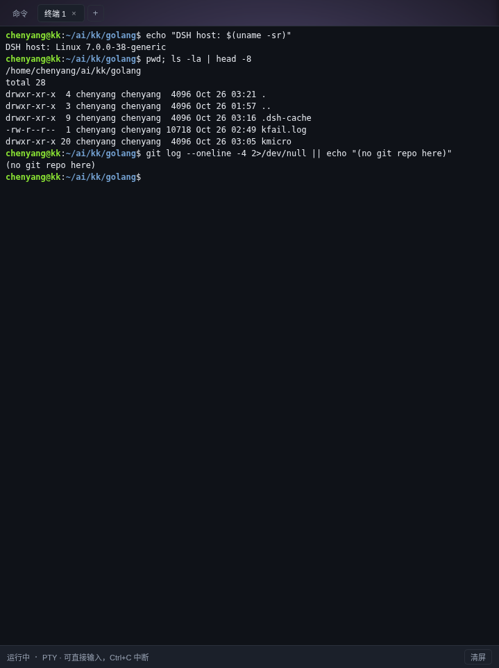

# dsh-cmd-live

DSH 的右侧边栏面板，两件事：

1. **命令列表**（「命令」页签）：宿主每跑一条 shell 命令就出现一行，选中即可看它**实时**的 stdout/stderr，能停止、复制、搜索，列表与输出之间的分栏可拖；
2. **真实终端**（「终端 N」页签）：一个真正的 PTY + xterm，能直接敲命令、Ctrl+C、全屏程序、颜色和补全；进程活在宿主里，刷新页面会重新接上。

终端只用于人机交互，不会把输出塞进对话；命令列表里的停止按钮也不会启动任何新命令——唯一的写接口是 `POST /cmd-live/kill` 和终端自己的输入接口。



## 它看到的是哪些命令

所有经过 `ctx.shell` 的命令：

- 模型调用的 `bash` 工具（前台、`run_in_background` 的后台任务都算）；
- 子代理、workflow 里的命令；
- hooks 桥接器执行的命令；
- 任何插件通过 `ctx.shell.execute()` 发起的命令。

不经过 shell 的能力不会出现在这里：`browser_*`、文件读写、`test_live_run`（它自己 spawn 子进程）等。终端面板里的交互式 PTY 也算另一套通道。

## 安装

```sh
dsh plugin --profile web add github:stcn52/dsh-cmd-live
```

装完刷新页面，右侧边栏会多一个「命令」页签（也可以从右侧栏的引导页打开）。

## 终端页签

- 打开面板时自动恢复宿主里已有的终端；没有就新建一个（`$SHELL -l`，工作目录是宿主进程的 cwd）；
- `+` 新建，页签上的 `×` 结束进程；
- 键盘输入直通 PTY：`Ctrl+C`、`Ctrl+D`、方向键、Tab 补全都由 shell 自己处理；
- 面板宽度变化时自动 `fit` 并同步 `TIOCSWINSZ`；xterm 字体用系统等宽字体；
- 会话在宿主进程里，刷新页面、切页签都不杀进程；结束或卸载插件时才终止。

xterm 5.5 的 UMD 构建直接放在本包的 `vendor/` 里（MIT，附 LICENSE），由 `/cmd-live/vendor/*` 同源提供，不依赖 CDN。

## 命令页签

上半部分是命令列表（类似 VS Code 的进程列表），下半部分是选中命令的输出：

- **筛选**：全部 / 运行中 / 失败；输入框按命令或目录搜索；
- **选择**：点一行或按 ↑↓ / Home / End 切换；新命令开始时自动选中最新一条（可关）；一旦手动选了别的，就不抢焦点，「最新」按钮可以回到自动跟随；
- **停止**：详情栏的「停止」或行尾悬停的 ■，向进程组发 SIGTERM（会二次确认）；
- **复制输出**：复制当前保留的输出（HTTP + 局域网下自动退回 `execCommand`）；
- **跟随**：新输出到达自动滚到底；往上滚自动暂停，右下角「↓ 回到最新」恢复；
- **分栏**：拖动列表与输出之间的分隔条调整比例，双击？不需要，比例会记住；
- **全文**：新标签页打开 `/cmd-live/text?id=…` 纯文本；
- 详情显示工作目录、限时、已耗时（运行中每 0.5s 跳一次）、退出码 / 超时 / 被停止、行数、截断标记。

## 配置

在 profile 的 `cordis.patch.yml` 里按 id 覆盖：

```yaml
- id: cmd-live
  config:
    maxCommands: 60      # 保留多少条已结束命令（运行中的不会被挤掉）
    maxLines: 400        # 每条命令保留多少行输出
    maxBytes: 262144     # 每条命令保留多少字节输出
    pollIntervalMs: 350  # 宿主轮询执行句柄的间隔
    terminal:
      shell: null        # 绝对路径；null = $SHELL 或 /bin/bash
      cwd: null          # 绝对路径；null = 宿主进程 cwd
      cols: 100
      rows: 28
      maxChunks: 4000    # 回放缓冲的块数上限
      maxBytes: 1048576  # 回放缓冲的字节上限
```

## HTTP 接口

| 方法 | 路径 | 说明 |
| --- | --- | --- |
| GET | `/cmd-live/commands` | 当前保留的命令列表，运行中在前 |
| GET | `/cmd-live/output?id=&since=` | 某条命令从 `since` 序号开始的输出行 |
| GET | `/cmd-live/text?id=` | 某条命令的纯文本输出（stderr 行带 `[stderr]` 前缀） |
| GET | `/cmd-live/stream` | SSE：先 `event: init` 快照，再推 `start` / `output` / `end` |
| POST | `/cmd-live/kill` | 停止一条运行中的命令，body `{"id":"cmd_…"}` |
| GET | `/cmd-live/term/list` | 宿主里的终端会话 |
| POST | `/cmd-live/term/create` | 分配一个 PTY，body `{cols,rows}` |
| GET | `/cmd-live/term/stream?id=&since=` | SSE：先 `event: init`（含回放），再推 `data` / `exit` |
| POST | `/cmd-live/term/input` | 写入终端输入 `{id,data}` |
| POST | `/cmd-live/term/resize` | 调整 PTY 网格 `{id,cols,rows}` |
| POST | `/cmd-live/term/close` | 结束终端 `{id}` |
| GET | `/cmd-live/vendor/xterm.js` 等 | 同源提供 vendored xterm 资源 |

SSE 事件格式：

```text
event: init
data: {"commands":[…],"serverTime":1780000000000}

event: output
data: {"id":"cmd_1_ab12","lines":[{"seq":0,"kind":"out","text":"hello"}]}
```

输出被截断时，服务端会发 `{"reset":true,"lines":[…],"floorSeq":N}`，客户端整段替换而不是追加。

## 实现方式

- 终端走 `ctx.subprocess.spawnTerminal`（和内置终端同一个 PTY 背板），输出经 `StringDecoder` 解码后按块回放，浏览器用 vendored xterm 渲染；
- 插件用 `ctx.inject(['shell'], …)` 拿到执行器，在**原始实例**（`Symbol.for('cordis.original')`，绕过 cordis 的 traceable 代理）上包一层 `execute`；
- 原样调用原方法，把返回的执行句柄交给注册表（句柄同时留着 `kill()` 供面板停止）；
- 注册表按 `pollIntervalMs` 轮询 `execution.observed.stdout/stderr` 的偏移读取器（非消费式，不会抢走工具自己的输出游标）；
- 进程关闭时 `result()` 给出 `timedOut` / `aborted` 分类，据此标记状态；
- 卸载插件时恢复原方法并清空记录。

## 已知限制

- **只在内存里**：宿主重启即清空，不落盘。
- **stdout / stderr 分开读**：同一毫秒内两个流的先后顺序无法还原，面板里先列 stdout 再列 stderr。
- **只保留尾部**：超过 `maxLines` / `maxBytes` 的旧行会被丢掉，面板会标记「截断」。
- **文本不是终端**：没有 ANSI 颜色；`bash-local` 默认带 `NO_COLOR=1 TERM=dumb`，所以绝大多数命令本来就是纯文本。
- **多实例宿主**：监视的是当前宿主进程；不同端口上的另一个宿主不会出现在这个面板里。

## 开发

```sh
node --test tests/*.test.js
```

改完要 `commit + push`，然后 `dsh plugin --profile web remove dsh-cmd-live && dsh plugin --profile web add github:stcn52/dsh-cmd-live` 切到新 commit（pnpm 按 commit 拉 tarball）。

运行中的宿主对已经加载过的插件有模块缓存（按启动时解析到的路径），所以：

- **宿主侧改动**（`src/index.js`、`src/core/*`、`src/host/*`）重装不会生效，要重启宿主；
- **客户端改动**（`src/client/index.js`）由 `client-hmr` 每 500ms 轮询文件元数据自动重发 bundle，刷新页面即可；
- 如果重装换了新的 pnpm store 目录，HMR 仍盯着旧目录。把新文件覆盖到旧目录那份（或用 `dsh` 的重启流程）就会触发重发。

MIT License.
